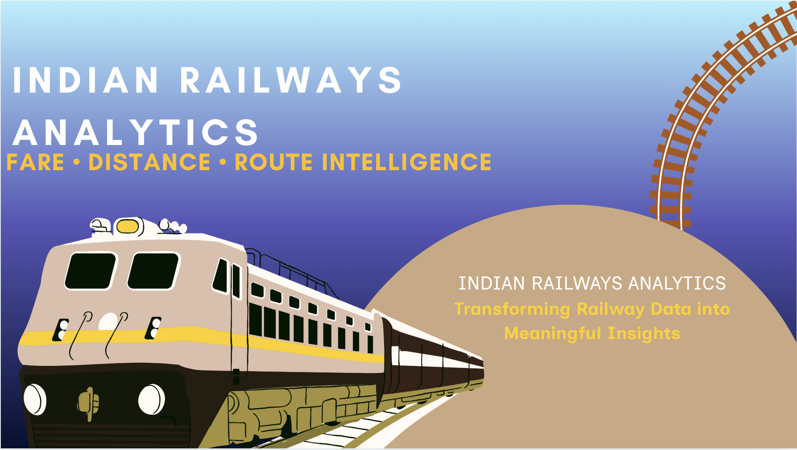

# 🚆 Indian Railways — Fare, Distance & Route Intelligence

<p align="center">
  
</p>

<p align="center">
  <strong>Power BI Dashboard | Data Analytics | Business Intelligence</strong>
</p>

<p align="center">
  An interactive analytics project exploring railway fares, travel distances, fare components, train coverage, and route-level patterns using Power BI and DAX.
</p>

---

## 📌 Project Overview

The **Indian Railways Analytics Dashboard** is an interactive Power BI project designed to analyze railway fare data and turn raw records into meaningful insights.

The report combines fare analysis, distance metrics, additional charge analysis, train coverage, and route-level exploration in a multi-page dashboard. It uses DAX measures and data modeling to support comparisons across available train, class, station, and route dimensions.

### 🎯 Project Objectives

- Analyze total and average fares across available records.
- Compare base fares with total fares and additional charges.
- Explore fare-per-kilometre metrics and distance patterns.
- Examine fare components such as reservation, catering, service tax, dynamic fare, and superfast charges.
- Measure distinct train coverage and origin–destination route combinations.
- Present findings through interactive Power BI visualizations.

## 🛠️ Tools & Technologies

- **Power BI Desktop** — Dashboard development and visualization
- **DAX** — Measures and analytical calculations
- **Power Query** — Data preparation and transformation
- **Data Modeling** — Organizing tables and analytical relationships
- **Microsoft Excel / CSV** — Data storage and source-file handling, where applicable

## 📊 Dashboard Preview

### 1. Overview Dashboard

Provides a high-level view of railway fare metrics and train or route coverage.


### 2. Fare & Distance Analysis

Explores fare patterns, distance metrics, and fare-per-kilometre comparisons.


### 3. Key Insights

Highlights the major findings and comparisons available in the report.


### 4. Data Model

Shows the data model used to organize the report's analytical data.


## 🔍 Key Analytical Areas

### 💰 Fare Analysis
- Total fare value
- Average, highest, and lowest fare
- Average base fare
- Difference between average total fare and average base fare
- Fare markup percentage

### 🚄 Distance & Fare Efficiency
- Total and average recorded distance
- Average fare per kilometre
- Overall fare per kilometre, calculated as total fare divided by total recorded distance

### 🧾 Fare Component Analysis
- Reservation charge
- Superfast charge
- Service tax
- Dynamic fare
- Catering charge
- Other charges

### 🛤️ Train & Route Coverage
- Distinct train count
- Unique origin–destination combinations
- Comparisons using the report's available train, class, station, and route filters

## 📐 DAX Measures

The project includes **19 DAX measures** for fare analysis, distance calculations, charge comparisons, and train and route coverage.

| Category | Example Measures |
|---|---|
| Fare & Revenue | Total Fare Value, Fare Average, Highest Fare, Lowest Fare |
| Fare Comparison | Base Fare Average, Additional Charges Average, Fare Markup % |
| Distance | Distance Total, Distance Average |
| Fare Efficiency | Average Fare per KM, Overall Fare per KM |
| Charge Analysis | Reservation Charge Average, Catering Charge Average, Service Tax Average |
| Train & Route | Active Train Count, Unique Route Count |

Detailed formulas are documented here:

- [DAX Measures Documentation](measures/DAX_Measures.md)
- [DAX Measures Reference File](DAX_Measures.dax)

**Calculation note:** `Additional Charges Average` represents the difference between average total fare and average base fare. It is not necessarily the average of the sum of every individual additional charge.

## 💡 Business Questions Explored

This dashboard is designed to help explore questions such as:

1. How do average and total fares vary across the available data?
2. What is the difference between base fare and total fare?
3. How do fare-per-kilometre metrics compare?
4. What are the average values of different fare components?
5. How many distinct train numbers and origin–destination combinations appear in the filtered data?
6. How do available report filters change the results and comparisons?

## 📁 Repository Structure

```text
indian-railways-analytics/
│
├── Dashboard/
│   ├── railways-banner.png
│   ├── overview.png
│   ├── analysis.png
│   ├── insights.png
│   └── DataModelling.png
│
├── measures/
│   └── DAX_Measures.md
│
├── DAX_Measures.dax
├── README.md
├── Indian_Railways_Analytics.pbix
└── Dataset/
    └── Source data files
```

*Note: This structure illustrates the intended organization. Keep the actual filenames and folder names in this README aligned with the files in the repository.*

## 🚀 How to Explore the Project

1. Clone or download this repository.
2. Open the `.pbix` file using Power BI Desktop.
3. If prompted, update the source-data path to match your local dataset location.
4. Refresh the data if required.
5. Navigate through the report pages and interact with the available filters and visualizations.

## 📈 Skills Demonstrated

- Data analysis and exploratory analysis
- Power BI dashboard development
- DAX measure creation
- Data modeling
- KPI design and reporting
- Fare and distance metric analysis
- Analytical storytelling and business-question framing
- Technical documentation using Markdown

## ⚠️ Data & Interpretation Notes

- Findings depend on the supplied dataset and its level of detail.
- A distinct train number in the data does not independently confirm that a train is currently operating.
- A unique route is counted as a distinct combination of `From Station` and `To Station`; it does not necessarily represent every physical railway segment.
- Fare averages and totals respond to the current filter context.
- The dashboard should be interpreted as an analysis of the available data, not as a live railway timetable or real-time fare service.

## 👨‍💻 Author

**Shubham Raj**

Aspiring Data Analyst | Power BI | SQL | Python

- GitHub: [shubhamraj-65](https://github.com/shubhamraj-65)
- LinkedIn: [Connect with me](https://www.linkedin.com/in/shubham-raj-6bb8b7273/)

---

<p align="center">
  <strong>Turning railway data into meaningful insights through analytics.</strong>
</p>
